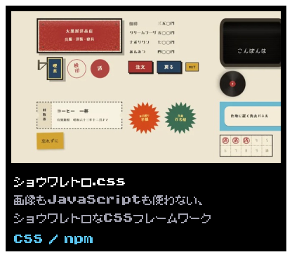
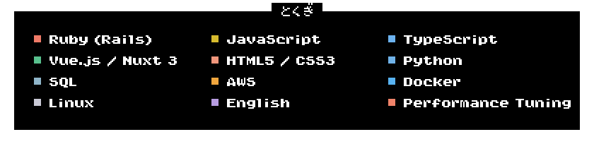
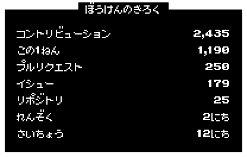
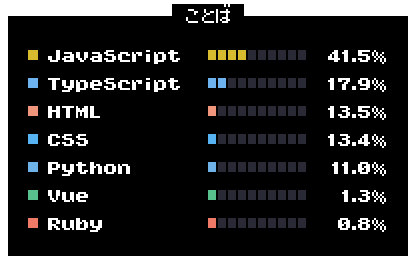
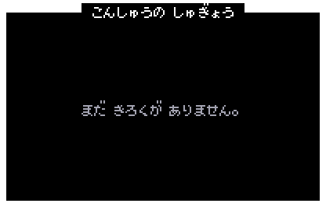
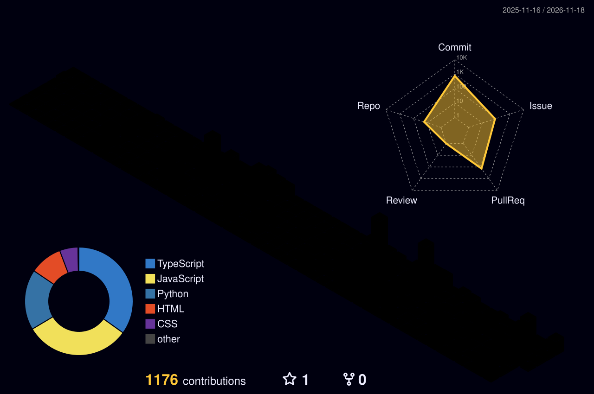

<!--
  画像は tools/build.cjs で作っている。文言を変えるときはそちらを直して作り直す。
  STATUS の4枚 (stat-*.svg) は tools/stats.cjs が、widgets/ と profile-3d-contrib/ は既製の Action が、
  毎日作り直す (.github/workflows/widgets.yml)。
  <picture> の中は改行しない (空白が入ると、リンクの下線が画像の横に小さく出る)。
-->

<div align="center">

<a href="https://kanade0525.github.io/portfolio/"><picture><source media="(prefers-color-scheme: dark)" srcset="https://raw.githubusercontent.com/kanade0525/kanade0525/main/assets/header-dark.svg" /><source media="(prefers-color-scheme: light)" srcset="https://raw.githubusercontent.com/kanade0525/kanade0525/main/assets/header-light.svg" /></picture></a>

<br>

<picture><source media="(prefers-color-scheme: dark)" srcset="https://raw.githubusercontent.com/kanade0525/kanade0525/main/assets/heading-works-dark.svg" /><source media="(prefers-color-scheme: light)" srcset="https://raw.githubusercontent.com/kanade0525/kanade0525/main/assets/heading-works-light.svg" /></picture>

<p>
  <a href="https://github.com/kanade0525/getting-secure-it"><picture><source media="(prefers-color-scheme: dark)" srcset="https://raw.githubusercontent.com/kanade0525/kanade0525/main/assets/work-getting-secure-it-dark.svg" /><source media="(prefers-color-scheme: light)" srcset="https://raw.githubusercontent.com/kanade0525/kanade0525/main/assets/work-getting-secure-it-light.svg" /></picture></a>
  <a href="https://github.com/kanade0525/roguelike-game"><picture><source media="(prefers-color-scheme: dark)" srcset="https://raw.githubusercontent.com/kanade0525/kanade0525/main/assets/work-roguelike-game-dark.svg" /><source media="(prefers-color-scheme: light)" srcset="https://raw.githubusercontent.com/kanade0525/kanade0525/main/assets/work-roguelike-game-light.svg" /></picture></a>
</p>
<p>
  <a href="https://github.com/kanade0525/showa-retro-css"><picture><source media="(prefers-color-scheme: dark)" srcset="https://raw.githubusercontent.com/kanade0525/kanade0525/main/assets/work-showa-retro-css-dark.svg" /><source media="(prefers-color-scheme: light)" srcset="https://raw.githubusercontent.com/kanade0525/kanade0525/main/assets/work-showa-retro-css-light.svg" /></picture></a>
  <a href="https://github.com/kanade0525/oyayubi-dojo"><picture><source media="(prefers-color-scheme: dark)" srcset="https://raw.githubusercontent.com/kanade0525/kanade0525/main/assets/work-oyayubi-dojo-dark.svg" /><source media="(prefers-color-scheme: light)" srcset="https://raw.githubusercontent.com/kanade0525/kanade0525/main/assets/work-oyayubi-dojo-light.svg" /></picture></a>
</p>

ほかの作品は [ポートフォリオ](https://kanade0525.github.io/portfolio/) にあります。

<br>

<picture><source media="(prefers-color-scheme: dark)" srcset="https://raw.githubusercontent.com/kanade0525/kanade0525/main/assets/heading-skill-dark.svg" /><source media="(prefers-color-scheme: light)" srcset="https://raw.githubusercontent.com/kanade0525/kanade0525/main/assets/heading-skill-light.svg" /></picture>

<picture><source media="(prefers-color-scheme: dark)" srcset="https://raw.githubusercontent.com/kanade0525/kanade0525/main/assets/skills-dark.svg" /><source media="(prefers-color-scheme: light)" srcset="https://raw.githubusercontent.com/kanade0525/kanade0525/main/assets/skills-light.svg" /></picture>

<picture><source media="(prefers-color-scheme: dark)" srcset="https://skillicons.dev/icons?i=ruby%2Crails%2Cjs%2Cts%2Cvue%2Cnuxtjs%2Chtml%2Ccss%2Cpy%2Caws%2Cdocker%2Clinux&theme=dark" /><source media="(prefers-color-scheme: light)" srcset="https://skillicons.dev/icons?i=ruby%2Crails%2Cjs%2Cts%2Cvue%2Cnuxtjs%2Chtml%2Ccss%2Cpy%2Caws%2Cdocker%2Clinux&theme=light" /></picture>

<br>

<picture><source media="(prefers-color-scheme: dark)" srcset="https://raw.githubusercontent.com/kanade0525/kanade0525/main/assets/heading-status-dark.svg" /><source media="(prefers-color-scheme: light)" srcset="https://raw.githubusercontent.com/kanade0525/kanade0525/main/assets/heading-status-light.svg" /></picture>

<p>
  <picture><source media="(prefers-color-scheme: dark)" srcset="https://raw.githubusercontent.com/kanade0525/kanade0525/main/assets/stat-record-dark.svg" /><source media="(prefers-color-scheme: light)" srcset="https://raw.githubusercontent.com/kanade0525/kanade0525/main/assets/stat-record-light.svg" /></picture>
  <picture><source media="(prefers-color-scheme: dark)" srcset="https://raw.githubusercontent.com/kanade0525/kanade0525/main/assets/stat-langs-dark.svg" /><source media="(prefers-color-scheme: light)" srcset="https://raw.githubusercontent.com/kanade0525/kanade0525/main/assets/stat-langs-light.svg" /></picture>
</p>
<p>
  <picture><source media="(prefers-color-scheme: dark)" srcset="https://raw.githubusercontent.com/kanade0525/kanade0525/main/assets/stat-recent-dark.svg" /><source media="(prefers-color-scheme: light)" srcset="https://raw.githubusercontent.com/kanade0525/kanade0525/main/assets/stat-recent-light.svg" /></picture>
  <picture><source media="(prefers-color-scheme: dark)" srcset="https://raw.githubusercontent.com/kanade0525/kanade0525/main/assets/stat-waka-dark.svg" /><source media="(prefers-color-scheme: light)" srcset="https://raw.githubusercontent.com/kanade0525/kanade0525/main/assets/stat-waka-light.svg" /></picture>
</p>

<p>
  <picture><source media="(prefers-color-scheme: dark)" srcset="https://raw.githubusercontent.com/kanade0525/kanade0525/main/widgets/stats-dark.svg" /><source media="(prefers-color-scheme: light)" srcset="https://raw.githubusercontent.com/kanade0525/kanade0525/main/widgets/stats-light.svg" /></picture>
  <picture><source media="(prefers-color-scheme: dark)" srcset="https://raw.githubusercontent.com/kanade0525/kanade0525/main/widgets/top-langs-dark.svg" /><source media="(prefers-color-scheme: light)" srcset="https://raw.githubusercontent.com/kanade0525/kanade0525/main/widgets/top-langs-light.svg" /></picture>
</p>

<picture><source media="(prefers-color-scheme: dark)" srcset="https://streak-stats.demolab.com?user=kanade0525&background=000000&border=ffffff&stroke=ffffff&ring=f7d51d&fire=e76e55&currStreakNum=ffffff&sideNums=ffffff&currStreakLabel=f7d51d&sideLabels=ffffff&dates=a2a2b0&border_radius=0&locale=ja&date_format=%5BY.%5Dn.j" /><source media="(prefers-color-scheme: light)" srcset="https://streak-stats.demolab.com?user=kanade0525&background=ffffff&border=212529&stroke=212529&ring=a88a00&fire=b5432e&currStreakNum=333333&sideNums=333333&currStreakLabel=a88a00&sideLabels=333333&dates=6b6b6b&border_radius=0&locale=ja&date_format=%5BY.%5Dn.j" /></picture>

<picture><source media="(prefers-color-scheme: dark)" srcset="https://raw.githubusercontent.com/kanade0525/kanade0525/main/widgets/trophy-dark.svg" /><source media="(prefers-color-scheme: light)" srcset="https://raw.githubusercontent.com/kanade0525/kanade0525/main/widgets/trophy-light.svg" /></picture>

<br>

<picture><source media="(prefers-color-scheme: dark)" srcset="https://raw.githubusercontent.com/kanade0525/kanade0525/main/assets/heading-activity-dark.svg" /><source media="(prefers-color-scheme: light)" srcset="https://raw.githubusercontent.com/kanade0525/kanade0525/main/assets/heading-activity-light.svg" /></picture>

<picture><source media="(prefers-color-scheme: dark)" srcset="https://raw.githubusercontent.com/kanade0525/kanade0525/main/profile-3d-contrib/profile-night-rainbow.svg" /><source media="(prefers-color-scheme: light)" srcset="https://raw.githubusercontent.com/kanade0525/kanade0525/main/profile-3d-contrib/profile-season-animate.svg" /></picture>

<picture><source media="(prefers-color-scheme: dark)" srcset="https://raw.githubusercontent.com/kanade0525/kanade0525/output/github-snake-dark.svg" /><source media="(prefers-color-scheme: light)" srcset="https://raw.githubusercontent.com/kanade0525/kanade0525/output/github-snake.svg" /></picture>


</div>

<br>

<details>
<summary>WakaTime</summary>
<br>

<!--START_SECTION:waka-->


**I'm an Early 🐤** 

```text
🌞 Morning                2020 commits        ████░░░░░░░░░░░░░░░░░░░░░   16.41 % 
🌆 Daytime                4304 commits        █████████░░░░░░░░░░░░░░░░   34.97 % 
🌃 Evening                4246 commits        █████████░░░░░░░░░░░░░░░░   34.50 % 
🌙 Night                  1736 commits        ████░░░░░░░░░░░░░░░░░░░░░   14.11 % 
```
📅 **I'm Most Productive on Monday** 

```text
Monday                   2245 commits        █████░░░░░░░░░░░░░░░░░░░░   18.24 % 
Tuesday                  1752 commits        ████░░░░░░░░░░░░░░░░░░░░░   14.24 % 
Wednesday                1880 commits        ████░░░░░░░░░░░░░░░░░░░░░   15.28 % 
Thursday                 1778 commits        ████░░░░░░░░░░░░░░░░░░░░░   14.45 % 
Friday                   1096 commits        ██░░░░░░░░░░░░░░░░░░░░░░░   08.91 % 
Saturday                 1998 commits        ████░░░░░░░░░░░░░░░░░░░░░   16.24 % 
Sunday                   1557 commits        ███░░░░░░░░░░░░░░░░░░░░░░   12.65 % 
```


📊 **This Week I Spent My Time On** 

```text
🕑︎ Time Zone: Asia/Tokyo

💬 Programming Languages: 
No Activity Tracked This Week

🔥 Editors: 
No Activity Tracked This Week

🐱‍💻 Projects: 
No Activity Tracked This Week

💻 Operating System: 
No Activity Tracked This Week
```

🤖 **AI Coding This Week** 

```text
No AI Coding Activity Tracked This Week
```

**I Mostly Code in JavaScript** 

```text
JavaScript               15 repos            ██████████░░░░░░░░░░░░░░░   41.67 % 
Ruby                     6 repos             ████░░░░░░░░░░░░░░░░░░░░░   16.67 % 
TypeScript               6 repos             ████░░░░░░░░░░░░░░░░░░░░░   16.67 % 
HTML                     4 repos             ███░░░░░░░░░░░░░░░░░░░░░░   11.11 % 
Python                   2 repos             █░░░░░░░░░░░░░░░░░░░░░░░░   05.56 % 
```


 Last Updated on 19/11/2026 06:57:36 UTC
<!--END_SECTION:waka-->

</details>
