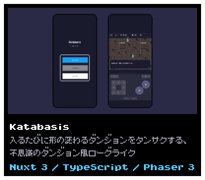
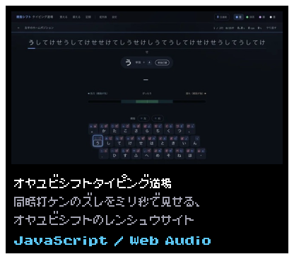

<!--
  画像は tools/build.cjs で作っている。文言を変えるときはそちらを直して作り直す。
  <picture> の中は改行しない (空白が入ると、リンクの下線が画像の横に小さく出る)。
-->

<div align="center">

<a href="https://kanade0525.github.io/portfolio/"><picture><source media="(prefers-color-scheme: dark)" srcset="https://raw.githubusercontent.com/kanade0525/kanade0525/main/assets/header-dark.svg" /><source media="(prefers-color-scheme: light)" srcset="https://raw.githubusercontent.com/kanade0525/kanade0525/main/assets/header-light.svg" /></picture></a>

<br>

<picture><source media="(prefers-color-scheme: dark)" srcset="https://raw.githubusercontent.com/kanade0525/kanade0525/main/assets/heading-works-dark.svg" /><source media="(prefers-color-scheme: light)" srcset="https://raw.githubusercontent.com/kanade0525/kanade0525/main/assets/heading-works-light.svg" /></picture>

<p>
  <a href="https://github.com/kanade0525/getting-secure-it"><picture><source media="(prefers-color-scheme: dark)" srcset="https://raw.githubusercontent.com/kanade0525/kanade0525/main/assets/work-getting-secure-it-dark.svg" /><source media="(prefers-color-scheme: light)" srcset="https://raw.githubusercontent.com/kanade0525/kanade0525/main/assets/work-getting-secure-it-light.svg" /></picture></a>
  <a href="https://github.com/kanade0525/roguelike-game"><picture><source media="(prefers-color-scheme: dark)" srcset="https://raw.githubusercontent.com/kanade0525/kanade0525/main/assets/work-roguelike-game-dark.svg" /><source media="(prefers-color-scheme: light)" srcset="https://raw.githubusercontent.com/kanade0525/kanade0525/main/assets/work-roguelike-game-light.svg" /></picture></a>
</p>
<p>
  <a href="https://github.com/kanade0525/showa-retro-css"><picture><source media="(prefers-color-scheme: dark)" srcset="https://raw.githubusercontent.com/kanade0525/kanade0525/main/assets/work-showa-retro-css-dark.svg" /><source media="(prefers-color-scheme: light)" srcset="https://raw.githubusercontent.com/kanade0525/kanade0525/main/assets/work-showa-retro-css-light.svg" /></picture></a>
  <a href="https://github.com/kanade0525/oyayubi-dojo"><picture><source media="(prefers-color-scheme: dark)" srcset="https://raw.githubusercontent.com/kanade0525/kanade0525/main/assets/work-oyayubi-dojo-dark.svg" /><source media="(prefers-color-scheme: light)" srcset="https://raw.githubusercontent.com/kanade0525/kanade0525/main/assets/work-oyayubi-dojo-light.svg" /></picture></a>
</p>

ほかの作品は [ポートフォリオ](https://kanade0525.github.io/portfolio/) にあります。

<br>

<picture><source media="(prefers-color-scheme: dark)" srcset="https://raw.githubusercontent.com/kanade0525/kanade0525/main/assets/heading-skill-dark.svg" /><source media="(prefers-color-scheme: light)" srcset="https://raw.githubusercontent.com/kanade0525/kanade0525/main/assets/heading-skill-light.svg" /></picture>

<picture><source media="(prefers-color-scheme: dark)" srcset="https://raw.githubusercontent.com/kanade0525/kanade0525/main/assets/skills-dark.svg" /><source media="(prefers-color-scheme: light)" srcset="https://raw.githubusercontent.com/kanade0525/kanade0525/main/assets/skills-light.svg" /></picture>

<br>

<picture><source media="(prefers-color-scheme: dark)" srcset="https://raw.githubusercontent.com/kanade0525/kanade0525/main/assets/heading-activity-dark.svg" /><source media="(prefers-color-scheme: light)" srcset="https://raw.githubusercontent.com/kanade0525/kanade0525/main/assets/heading-activity-light.svg" /></picture>

<picture><source media="(prefers-color-scheme: dark)" srcset="https://raw.githubusercontent.com/kanade0525/kanade0525/output/github-snake-dark.svg" /><source media="(prefers-color-scheme: light)" srcset="https://raw.githubusercontent.com/kanade0525/kanade0525/output/github-snake.svg" /></picture>

</div>

<br>

<details>
<summary>WakaTime</summary>
<br>

<!--START_SECTION:waka-->


**I'm an Early 🐤** 

```text
🌞 Morning                1982 commits        ████░░░░░░░░░░░░░░░░░░░░░   16.34 % 
🌆 Daytime                4255 commits        █████████░░░░░░░░░░░░░░░░   35.07 % 
🌃 Evening                4205 commits        █████████░░░░░░░░░░░░░░░░   34.66 % 
🌙 Night                  1690 commits        ███░░░░░░░░░░░░░░░░░░░░░░   13.93 % 
```
📅 **I'm Most Productive on Monday** 

```text
Monday                   2193 commits        █████░░░░░░░░░░░░░░░░░░░░   18.08 % 
Tuesday                  1718 commits        ████░░░░░░░░░░░░░░░░░░░░░   14.16 % 
Wednesday                1865 commits        ████░░░░░░░░░░░░░░░░░░░░░   15.37 % 
Thursday                 1774 commits        ████░░░░░░░░░░░░░░░░░░░░░   14.62 % 
Friday                   1079 commits        ██░░░░░░░░░░░░░░░░░░░░░░░   08.89 % 
Saturday                 1983 commits        ████░░░░░░░░░░░░░░░░░░░░░   16.35 % 
Sunday                   1520 commits        ███░░░░░░░░░░░░░░░░░░░░░░   12.53 % 
```


📊 **This Week I Spent My Time On** 

```text
🕑︎ Time Zone: Asia/Tokyo

💬 Programming Languages: 
No Activity Tracked This Week

🔥 Editors: 
No Activity Tracked This Week

🐱‍💻 Projects: 
No Activity Tracked This Week

💻 Operating System: 
No Activity Tracked This Week
```

🤖 **AI Coding This Week** 

```text
No AI Coding Activity Tracked This Week
```

**I Mostly Code in JavaScript** 

```text
JavaScript               14 repos            ██████████░░░░░░░░░░░░░░░   40.00 % 
Ruby                     6 repos             ████░░░░░░░░░░░░░░░░░░░░░   17.14 % 
TypeScript               6 repos             ████░░░░░░░░░░░░░░░░░░░░░   17.14 % 
HTML                     4 repos             ███░░░░░░░░░░░░░░░░░░░░░░   11.43 % 
Python                   2 repos             █░░░░░░░░░░░░░░░░░░░░░░░░   05.71 % 
```


 Last Updated on 15/11/2026 02:54:03 UTC
<!--END_SECTION:waka-->

</details>
